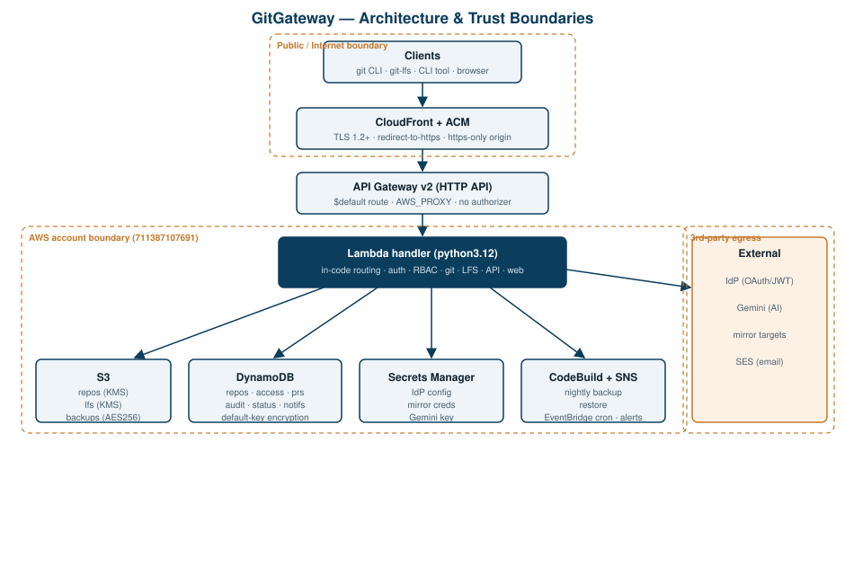
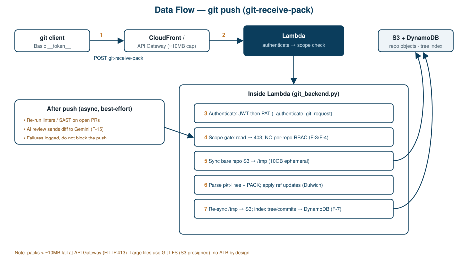

# GitGateway — Security Design Document

**Prepared for:** AWS SecAgent security review
**System:** GitGateway — serverless Git hosting platform
**Owner:** Topaz Bott
**Repository:** `git.botthouse.net` / `gitlab.botthouse.net:botthouse` (source)
**Document status:** Review draft

---

## 1. Purpose and Scope

This document describes the architecture, trust boundaries, data flows, and
security controls of GitGateway so that a security review can be performed
against it. It also records known gaps and deviations that the review should
scrutinize. The intent is full transparency: where a control is weaker than
the design goal claims, that is called out explicitly rather than omitted.

**In scope:** the CloudFormation-deployed AWS stack (CloudFront, API Gateway,
Lambda, S3, DynamoDB, CodeBuild, SNS, EventBridge, IAM), the application code
in the `gitgateway` package, authentication and authorization, data storage
and encryption, the Git Smart-HTTP data plane, secrets handling, and the AI
(Gemini) integration.

**Out of scope:** the upstream identity provider (`idp.botthouse.net`) internals,
client machines, and the corporate LDAP/AD directory. These are treated as
external trusted or semi-trusted systems at the boundary.

---

## 2. System Overview

GitGateway is a fully serverless Git host on AWS intended as a low-cost,
low-maintenance alternative to self-hosted GitLab. Standard `git clone/push/pull`
work over HTTPS. It also serves a web UI, a REST API, Git LFS, pull requests,
automated linting/SAST on pull requests, and optional AI code review.

The entire stack is defined in a single CloudFormation template
(`gitgateway/template.yaml`) and runs behind one Lambda function.

### 2.1 Request Path

```
Client (git CLI / browser / CLI tool)
        │  HTTPS (TLS 1.2+)
        ▼
CloudFront distribution  (ACM cert, redirect-to-https)
        │  https-only origin
        ▼
API Gateway v2 HTTP API  ($default route, AWS_PROXY, no authorizer)
        │
        ▼
Lambda  (python3.12, single handler, in-code routing + auth)
        │
        ├── S3        repos / lfs / backups
        ├── DynamoDB  repos, access, prs, comments, webhooks, status,
        │             audit, notifications, embeddings
        ├── Secrets Manager   IdP config, mirror creds, Gemini key
        ├── CodeBuild         nightly backup / restore
        ├── SNS               operational alerts
        └── External          IdP (OAuth/JWT), Gemini (AI), mirror, SES
```

### 2.2 Logical Routes (all resolved inside the Lambda)

| Path pattern | Handler | Auth model |
|---|---|---|
| `/<group>/<repo>.git/info/lfs/*` | LFS | Basic auth (`__token__`) |
| `/<group>/<repo>.git/*` | Git Smart HTTP | Basic auth (`__token__` + JWT or PAT) |
| `/api/*` | REST API | Session cookie / admin gate (partial) |
| `/auth/*` | OAuth callback | IdP redirect |
| `/*` | Web UI | Session cookie, redirect to IdP |

A single API Gateway `$default` route proxies **every** path to the Lambda.
There is no API Gateway authorizer; all authentication and authorization is
performed in application code.

### 2.3 Architecture Diagram



*Figure 1 — AWS resource topology and trust boundaries. All ingress is public
and TLS-terminated at CloudFront; auth is performed inside the Lambda. Data
services and third-party egress are shown with their respective boundaries.*

---

## 3. Trust Boundaries

1. **Internet → CloudFront/API Gateway.** Fully public ingress. TLS is
   terminated at CloudFront (TLS 1.2_2021 minimum, HTTP redirected to HTTPS).
2. **API Gateway → Lambda.** AWS-internal, IAM-authorized invocation
   (`apigateway.amazonaws.com` principal restricted to this API's execute-api ARN).
3. **Lambda → AWS data services.** Governed by the Lambda execution role
   (least-privilege-ish, scoped by resource ARN prefixes).
4. **Lambda → External services.** Outbound calls to the IdP (metadata/JWT
   verification), Google Gemini (AI), mirror targets, and SES. These carry or
   receive sensitive data and cross the AWS trust boundary.
5. **User → repository.** Enforced (intended) by the RBAC model
   (`readonly < contributor < admin`) at group and repo scope.

---

## 4. Authentication

### 4.1 Mechanisms

- **OAuth / JWT (RS256).** `gitgateway/auth.py::validate_jwt` decodes JWTs with
  the IdP public key fetched from `<IDP_URL>/metadata` (cached ~1 hour). It
  verifies the signature and the `iss` claim (`<IDP_URL>/metadata`) and reads
  the `sub`, `gitgateway-admin`, and `gitgateway-access` claims.
- **Personal Access Tokens (PATs).** `gitgateway/tokens.py`. Format
  `gg_<32 hex>` generated from `os.urandom(16)`. Only the **SHA-256 hash** is
  stored in DynamoDB; the raw token is shown once at creation. Validation checks
  existence, `revoked`, and expiry, and best-effort updates `last_used_at`.
- **Git Basic auth.** Username is the literal `__token__`; the password is
  either a JWT (short-lived, for CI) or a PAT (long-lived, for developers).
  `gitgateway/lambda_handler.py::_authenticate_git_request` tries JWT first,
  then PAT.
- **Web session cookies.** `gitgateway/auth.py::create_session_cookie` /
  `validate_session_cookie` use HMAC-SHA256 over a base64 JSON payload with an
  `exp`, compared with `hmac.compare_digest`. Logout clears the cookie with
  `HttpOnly; Secure; SameSite=Lax`.

### 4.2 Known authentication findings (flag for review)

- **F-1 — JWT audience verification is disabled.** `validate_jwt` sets
  `options={"verify_aud": False}`. A token minted for a different relying party
  by the same IdP would be accepted. Signature and issuer are still verified.
- **F-2 — Certificate extraction is string-based.** The IdP signing certificate
  is pulled from metadata by substring search for `<X509Certificate>` rather
  than a namespaced XML parse. Malformed or attacker-shaped metadata is a
  consideration if the metadata endpoint or its transport is ever compromised.
- **F-3 — Git JWT path hardcodes `read/write` scope.** When a JWT validates in
  `_authenticate_git_request`, the returned scope is unconditionally
  `read/write`, independent of the user's real entitlement.

---

## 5. Authorization (RBAC)

### 5.1 Model

Three levels — `readonly < contributor < admin` — defined in
`gitgateway/models.py` and resolved by `gitgateway/db.py::check_permission`.
Access is granted at group scope and/or repo scope; the **most permissive**
of the two applies.

### 5.2 Known authorization findings (flag for review)

- **F-4 — Git/LFS data plane does not call `check_permission`.** RBAC is
  enforced in the web-UI rendering paths (~15 call sites), but the Git dispatch
  path only performs a single check: if the operation is `git-receive-pack`
  (push) and the token scope is `read`, it returns 403. There is **no
  per-repo/per-group RBAC** on clone/fetch or push. Combined with F-3, any
  principal holding a valid JWT can push to any repository, and any
  authenticated principal can clone any repository. This is the highest-priority
  item for the review.
- **F-5 — Several `/api/*` mutating endpoints lack an auth check.** Group
  create/list/delete, access-control mutations, and branch registration
  (which writes directly to DynamoDB) are reachable without a verified caller
  in the paths reviewed. Admin-gated backup/restore endpoints do use an
  `is_admin` session check.

---

## 6. Data Storage and Encryption

| Store | Contents | Encryption at rest |
|---|---|---|
| S3 `*-repos` | Bare Git repositories (per-object) | SSE-KMS (`aws:kms`) |
| S3 `*-lfs` | Git LFS large objects | SSE-KMS (`aws:kms`) |
| S3 `*-backups` | Tiered backups (daily/weekly/monthly lifecycle) | SSE-S3 (`AES256`) |
| DynamoDB (all tables) | Metadata, access, PRs, audit, and an indexed tree of file content (≤1MB/file inlined) | AWS-owned key (default) |

- **Git data → S3.** Bare repos are stored under `repos/<group>/<repo>.git/`.
  On push, the local copy is synced back and stale S3 keys are deleted so S3
  mirrors repo state.
- **In transit.** CloudFront enforces TLS 1.2+ and redirect-to-https; the
  origin link is https-only; AWS SDK traffic uses TLS by default.

### 6.1 Known data findings (flag for review)

- **F-6 — Encryption claim vs. reality.** The design goal states "all data
  encrypted at rest (KMS)." In practice the repos and LFS buckets use KMS, but
  the **backup bucket is AES256** and **DynamoDB uses the default AWS-owned
  key**, not a customer-managed KMS key.
- **F-7 — Repository file content is copied into DynamoDB.** After each push the
  tree is indexed into the repos table with file content up to ~1MB inlined for
  web browsing. Source content therefore lives in two stores with different
  encryption postures.
- **F-8 — No explicit S3 public-access-block or bucket policy** is declared in
  the template; buckets rely on account-level defaults and IAM.

---

## 7. Git Smart-HTTP Data Plane

Two implementations exist. The **active** path is a pure-Python Dulwich
implementation (`gitgateway/git_backend.py`): it syncs the bare repo from S3 to
the Lambda's `/tmp` (10 GB ephemeral storage), handles `info/refs`,
`upload-pack` (clone/fetch), and `receive-pack` (push), then re-syncs to S3 and
re-indexes the tree/commits into DynamoDB. A legacy CGI path
(`gitgateway/git_http.py`) shells out to `git-http-backend` via `subprocess.run`
with a controlled binary path (`nosec B603`, 300s timeout).

### 7.1 Push Data Flow Diagram



*Figure 2 — End-to-end `git push` (`git-receive-pack`). Step 4 is the
authorization gate: it rejects read-scope tokens on push but performs no
per-repo/per-group RBAC (findings F-3/F-4). Steps 5–7 show the S3 ↔ /tmp sync
and the DynamoDB tree index (F-7). Post-push linting and AI review run
asynchronously and best-effort.*

### 7.2 Request-size limit

API Gateway HTTP APIs cap the request body at ~10 MB (a hard AWS limit). A push
whose pack exceeds ~10 MB fails with HTTP 413. Per the platform's architecture
constraints, this is **not** worked around with an ALB; large files are handled
via Git LFS (bytes go to S3 via presigned URLs and never enter the pack), and
oversized history is rewritten before import. The 20 MB "large transfer"
threshold in the legacy path only sets a response header and does not offload.

### 7.2 Known data-plane findings (flag for review)

- **F-9 — Input validation on names.** Group/repo names flow into S3 key
  prefixes and DynamoDB PK/SK without visible normalization/sanitization.
  Separator or traversal characters in names warrant review.
- **F-10 — Broad corrupt-repo recovery.** On any open/sync failure the backend
  reinitializes a fresh bare repo, which could mask corruption or data loss.

---

## 8. Secrets Management

- **AWS Secrets Manager** holds IdP config, mirror credentials, and the Gemini
  API key. The Lambda role grants `GetSecretValue`/`PutSecretValue`/`CreateSecret`
  scoped to `secret:gitgateway/*`.
- **PATs** are never stored raw (SHA-256 hash only).
- **Session cookies** are HMAC-signed; the signing secret is supplied by the caller.

### 8.1 Known secrets findings (flag for review)

- **F-11 — Gemini API key is sent as a URL query parameter**
  (`...:generateContent?key=<api_key>`) rather than a header, risking exposure in
  logs/traces.
- **F-12 — A real alert email address is a hardcoded default** in the template
  parameter for the SNS subscription.

---

## 9. Network Exposure and IAM

- **Public surface:** CloudFront + API Gateway, internet-facing, no API Gateway
  authorizer. Every route reaches the Lambda; auth is in-code (see §4–5).
- **CORS is wide open:** `Access-Control-Allow-Origin: *` on API responses.
- **S3 buckets** are not fronted by CloudFront and have no explicit public-access
  block in the template.
- **IAM roles** (all in `template.yaml`):
  - *Lambda execution role* — DynamoDB CRUD on `table/${prefix}-*` (wildcard),
    S3 object CRUD + list on the three buckets, Secrets Manager on
    `gitgateway/*`, self-`InvokeFunction`, `codebuild:StartBuild` on the backup
    project, `sns:Publish` on the alerts topic, plus `AWSLambdaBasicExecutionRole`.
  - *Backup CodeBuild role* — logs, S3 on the three buckets, DynamoDB read
    (Get/Query/Scan) wildcard, SNS publish.
  - *Backup schedule role* — `codebuild:StartBuild` only.
- **No VPC** is configured on the Lambda; it runs with public egress for IdP,
  Gemini, mirror, and SES calls.

### 9.1 Known network/IAM findings (flag for review)

- **F-13 — Wildcard resource scoping** on DynamoDB (`table/${prefix}-*`) in both
  Lambda and backup roles.
- **F-14 — Wide-open CORS** (`*`) on API responses.

---

## 10. AI (Gemini) Integration

AI review is opt-in per repository and posts as bot user `gitgateway-ai`.
`gitgateway/ai.py::call_gemini` POSTs to Google's Generative Language API.
`generate_pr_summary` and `generate_code_review` send the **PR unified diff
(truncated to ~8000 chars)** plus commit messages; `gitgateway/ai_sast.py`
sends SAST findings and surrounding code context for true/false-positive triage.

### 10.1 Known AI findings (flag for review)

- **F-15 — Data egress to a third party.** When AI is enabled, repository diffs
  and code context leave AWS to Google. This is a data-classification and
  contractual consideration.
- **F-16 — Rate limiter is in-memory per Lambda instance** (default 30
  calls/hour/repo), so the limit is not shared across concurrent invocations.
  The code comments note DynamoDB is the intended production backing.

---

## 11. Application Security Controls (SAST / linting)

On pull-request open and on push, GitGateway runs 16 linters/SAST tools via
subprocess (`gitgateway/lint.py`): pylint, bandit, ruff, mypy, yamllint, JSON,
TOML, checkov, cfn-lint, tflint, kubeval, shellcheck, hadolint, markdownlint,
eslint, sqlfluff. Per-linter status checks are posted to the PR, and Gemini
provides an AI review. This is the platform's SAST control surface for hosted
repositories (it scans *tenant* code, not the platform itself at runtime).

---

## 12. Consolidated Findings Register

Severity is rated as **impact × likelihood/exploitability** for a system that is
publicly reachable but requires an authenticated principal for the data plane.
The rationale column states why each finding lands where it does so the reviewer
can adjust with context.

| ID | Area | Finding | Severity | Rationale (impact × exploitability) |
|----|------|---------|----------|-------------------------------------|
| F-4 | AuthZ | Git/LFS data plane skips RBAC (`check_permission`) | **Critical** | Any authenticated principal can read/write **any** repo; trivially exploitable; breaks the core tenancy boundary. |
| F-3 | AuthN | Git JWT path hardcodes `read/write` scope | **High** | Directly amplifies F-4: every valid JWT becomes a write credential regardless of entitlement. |
| F-5 | AuthZ | Some `/api/*` mutations lack an auth check | **High** | Unauthenticated group/access/branch mutation is possible on affected routes; needs confirmation across all routes. |
| F-1 | AuthN | JWT audience verification disabled | **Medium** | Token minted for another SP by the same IdP is accepted; requires such a token to exist. Signature + issuer still verified. |
| F-15 | AI | Diff/code egress to Google when AI enabled | **Medium** | Confidentiality impact (source leaves AWS), but opt-in per repo, so exposure is scoped and operator-controlled. |
| F-11 | Secrets | Gemini key in URL query string | **Medium** | Key can surface in logs/traces; not directly attacker-reachable, but a real disclosure path. |
| F-9 | Input | Group/repo names unsanitized into S3/DDB keys | **Medium** | Potential key/prefix manipulation; impact bounded by IAM prefix scoping and needs a working injection vector. |
| F-14 | Network | CORS `Access-Control-Allow-Origin: *` | **Medium** | Enables cross-origin API use from any site; impact tied to browser-based auth, which is cookie-gated. |
| F-6 | Data | KMS claim not universal (backups AES256, DDB default key) | **Low** | Data is still encrypted at rest; gap is key ownership/rotation control, not plaintext exposure. |
| F-7 | Data | Repo file content duplicated into DynamoDB | **Low** | Increases blast radius/data sprawl; access still gated by the same IAM role. |
| F-8 | Data | No explicit S3 public-access block / bucket policy | **Low** | Relies on account defaults; low risk if account-level BPA is on — confirm. |
| F-13 | IAM | Wildcard DynamoDB resource scoping (`table/${prefix}-*`) | **Low** | Over-broad within the stack's own namespace; no cross-stack reach. |
| F-2 | AuthN | String-based IdP cert extraction | **Low** | Only exploitable if IdP metadata/transport is already compromised. |
| F-16 | AI | In-memory-only rate limiter | **Low** | Availability/cost control weakness, not a confidentiality/integrity issue. |
| F-12 | Secrets | Hardcoded default alert email in template | **Low** | Information/hygiene issue; overridable at deploy time. |
| F-10 | Data plane | Broad corrupt-repo reinit may mask data loss | **Low** | Integrity/availability edge case; triggered only on open/sync failure. |

**Distribution:** 1 Critical, 2 High, 4 Medium, 8 Low. The Critical and both
High findings cluster on the git data-plane authorization gap (F-4/F-3) and the
API auth gap (F-5); addressing repo-scoped `check_permission` enforcement in the
git/LFS/API paths closes the majority of real risk. Severities are the author's
estimate and are offered for the reviewer to confirm or adjust.

---

## 13. Assumptions and Verification Notes

- Findings are grounded in the current source (`gitgateway/` package and
  `template.yaml`). The LFS handler and every `/api/*` branch were not read
  line-by-line; F-5 is based on the endpoints inspected and should be confirmed
  across all API routes.
- No AWS WAF is present in the template.
- DynamoDB encryption is stated as AWS-owned-key based on the absence of an
  explicit `SSESpecification`; confirm against the deployed tables.
- The Secrets Manager read/write module was inferred from IAM grants and docs
  rather than read directly.
